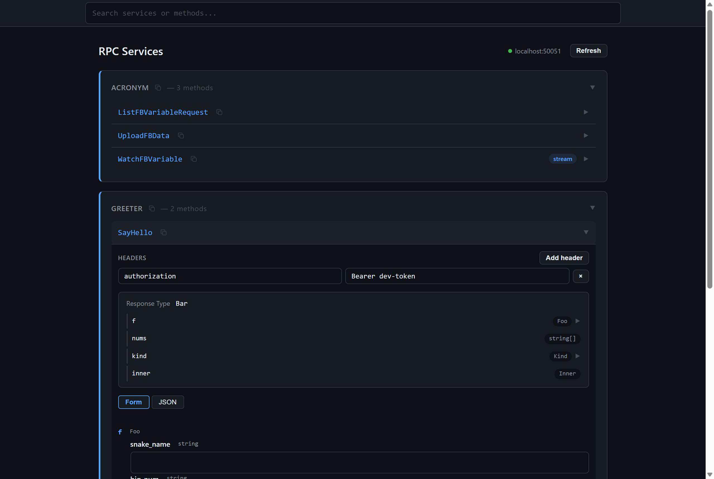
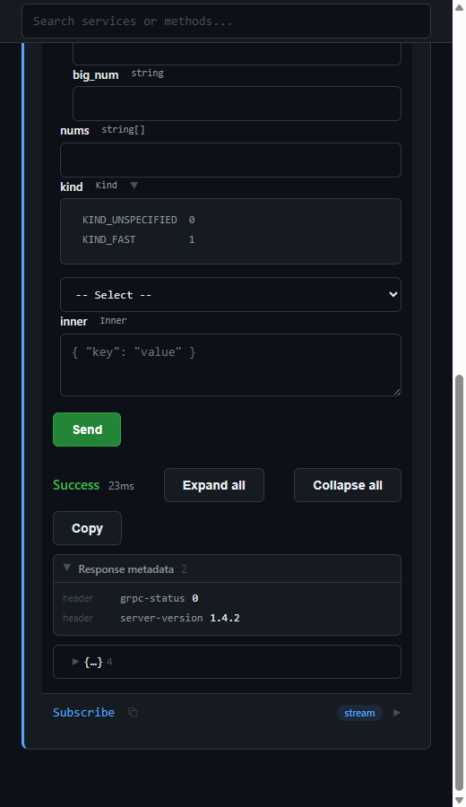
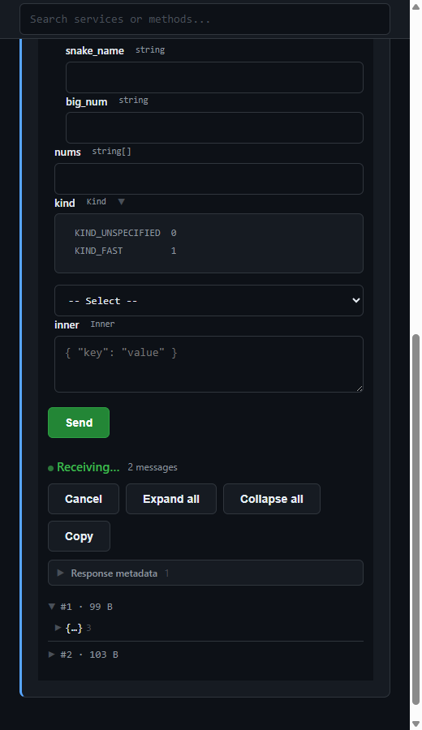
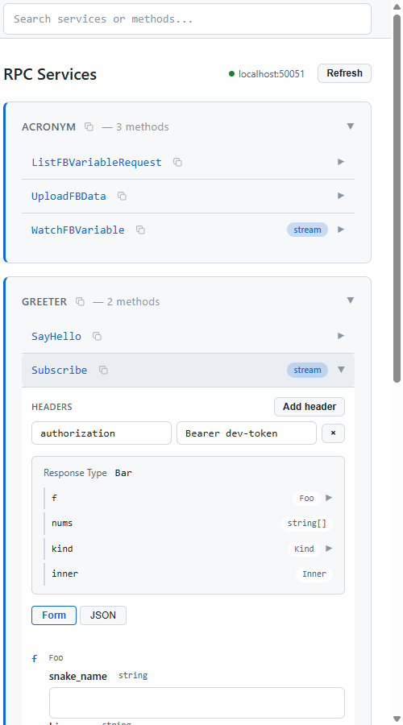

# Proto Utils

English | [中文文档](https://github.com/gp5251/proto_utils/blob/main/README.zh-CN.md)

An all-in-one Proto3 extension for VS Code: **syntax highlighting · go-to-definition · hover docs · TypeScript type generation · in-editor gRPC calls**.
Zero external dependencies — no need to install `protoc`, `buf`, or any CLI tools.

## Feature Overview

| Capability | Description |
| --- | --- |
| 🖋 **Language Services** | Proto3 syntax highlighting with distinct colors for built-in scalars vs. custom types |
| 🔍 **Go-to-Definition & Hover** | Type navigation within same file / imports / package namespace; hover shows type summary and leading comments |
| 🧭 **Outline Navigation** | `message` / `enum` / `service` / rpc methods all appear in Outline and Symbol Search |
| 🏗 **TS Type Generation** | `message` / `enum` / `repeated` / `map` / `oneof` → TypeScript; `service` → `<Name>Client` interface (all 4 streaming directions) |
| 📞 **RPC Workbench** | Schema-driven forms; all four gRPC call directions; environments, history, grpcurl export, collapsible response tree, and zero-config single-file scope from the Call lens |
| 🔁 **Call Sequences** | Chain rpc methods with `{{stepN.path}}` / environment variables and step assertions; named sequences persist to workspace |
| 🩺 **Live Diagnostics** | Inline syntax errors, missing types and duplicate names highlighted at reference sites; one-click import fix |

## Screenshots

### RPC Workbench

Auto-generated request form from proto schema: each field shows type badge, optional/required marker, and proto comments; nested messages and enums expand inline; Headers editor attaches metadata to calls.



### Unary Call · Collapsible Response Tree

Response data displayed in a DevTools-style collapsible tree; long strings truncated, int64 round-tripped as strings for precision; "Response metadata" section shows server headers/trailers.



### Server Streaming · Chunk-based Folding

Server streams displayed chunk-by-chunk with individual expand; cancellable at any time; long streams retain only the latest 200 chunks while showing the true total count.



### Light Theme

Workbench colors automatically follow VS Code light/dark theme (GitHub Dark for dark, GitHub Light for light).



## Quick Start

1. Open a workspace containing `.proto` files — the extension indexes automatically.
2. **Generate types**: right-click a `.proto` file → *Generate TypeScript Types*, or `Ctrl+Shift+P` to run batch generation.
3. **Call gRPC**: click the "▶ Call" CodeLens above any rpc method, fill the form and send. The lens needs no configuration for a self-contained proto or same-directory imports; set `protoUtils.runner.protoDir` when imports cross directories, or when you want every service in a directory browsable in one list. Click the server address in the workbench header to edit it in place (remembered per workspace).

## Features

- Proto3 syntax highlighting for `.proto` files
- Distinct coloring for built-in scalar types vs. custom types
- Go-to-definition across same file, imported files, and package namespaces
- Hover on type references or definitions shows type summary (kind + qualified name) and leading comments
- Outline / symbol navigation: lists `message`, `enum`, `service`, and rpc methods under services
- Generates TypeScript types from `message`, `enum`, `repeated`, `map`, and `oneof`
- Generates `service` as client call interfaces (`<Name>Client`, streaming directions expressed with `AsyncIterable`)
- Auto-generates TypeScript `import type` from cross-file type references (`.ts` suffix by default; same-name types across modules get deterministic aliases)
- Single-file or batch generation for all protos
- "▶ Call" CodeLens above rpc methods opens the RPC Workbench with the method pre-selected — and, for files outside `protoUtils.runner.protoDir`, scopes it to that single file so calling works with no configuration at all
- RPC Workbench: schema-driven request forms with Timestamp/Duration/wrapper helpers; unary, server-streaming, client-streaming, and bidi calls; responses shown in a collapsible JSON tree; request history and Copy as grpcurl
- Environments: switch variable sets from `.proto-utils/environments.json`; use `{{name}}` in the server address, request fields, and Headers (keep secrets out of version control)
- Call Sequences: chain methods for sequential execution, aborting on call or assertion failure; later steps can use `{{stepN.path}}` and environment variables; server streams support `chunks[i]`; per-step response assertions (`eq` / `neq` / `contains` / `exists` / `notExists` / `lt` / `gt`); named sequences persist to `.proto-utils/sequences.json` for save/load/delete
- Project-level config: `.proto-utils/settings.json` (commit it to share with your team) overrides any `protoUtils.*` setting — flat dotted keys without the `protoUtils.` prefix; precedence: workbench address bar > project file > VS Code settings > defaults. Create it via **Proto Utils: Create Project Config File**
- Diagnostics on `.proto` save or workbench load: syntax errors highlighted inline (narrowed to the offending token), missing types / duplicates flagged at reference and declaration sites; workbench error cards show red squiggles at error points

## Usage

### Project-level Configuration

Run **Proto Utils: Create Project Config File** to generate `.proto-utils/settings.json` with default-valued example keys. Keys are the setting IDs without the `protoUtils.` prefix:

```json
{
  "runner.protoDir": "proto",
  "runner.timeoutMs": 30000,
  "codeGen.outputDir": "src/generated",
  "scan.excludeDirs": ["third_party"]
}
```

The file is meant to be committed — it gives the whole team the same defaults. Keys present in the file override VS Code settings (user and workspace); keys absent fall through. The server address edited in the workbench header still wins over everything. Changes apply live, except `runner.protoDir` / `scan.excludeDirs` which need a window reload (same as VS Code settings).

### Editing and Navigation

After opening a `.proto` file in a workspace, the extension activates and indexes all Proto3 files.

- Syntax highlighting applies automatically.
- Hold `Ctrl` and click a type name to jump to its `message` or `enum` definition.
- On macOS, use `Cmd` + click.

Cross-file navigation requires the target type's file to be in the current VS Code workspace and resolvable via Proto `import` or package name.

### Generating TypeScript Types

Generate types via either method:

1. Right-click a `.proto` file in the editor or explorer, select **Proto Utils: Generate TypeScript Types** (current file only) or **Proto Utils: Generate TypeScript Types (All Protos)** (all protos including cross-file import targets).
2. Open Command Palette and run the same commands. For single-file command via palette, have the target `.proto` file open first.

By default, generated files are written to the workspace `generated/` directory. Given a proto file at `protos/account/user.proto` (with all protos under `protos/`):

```proto
syntax = "proto3";

package account.profile;

message User {
  string user_name = 1;
  repeated string roles = 2;
}
```

Default (`pathMapping: "file"`) output path:

```text
generated/user.ts
```

Generated content:

```ts
// Generated by proto-utils. Do not edit.

export interface User {
  userName: string;
  roles: string[];
}
```

Each generation run overwrites the output file — do not manually edit generated files.

#### Naming and Self-containment

Generated files are standalone-compilable: every export name is unique and every reference resolves.

- Nested types are flattened to top-level exports. When two types would share a name (e.g. `Foo.Request` and `Bar.Request`), they get deterministic qualified names (`FooRequest`, `BarRequest`); top-level types keep their original names, and remaining collisions take numeric suffixes. Cross-file imports always use the target file's actual export names.
- Fields folded to the same camelCase name (e.g. `foo_bar` and `fooBar`) are both kept: one stays camelCase, the other falls back to its written name.
- Type names that are TypeScript reserved words or shadow built-ins used by the output (`Record`, `Promise`, `AsyncIterable`, `Uint8Array`) get a `_` suffix (e.g. `Record_`).
- Bundled well-known types (`google.protobuf.Timestamp`, `Struct`, …) are emitted as local declarations in each file that uses them — including the `Struct`/`Value` recursive closure — so no dangling imports; a WKT colliding with a local type takes a `GoogleProtobuf` prefix.
- Map keys that are not valid `Record` keys — `bigint` (from `int64Style: "bigint"`) and `bool` — fall back to `string`; an empty enum in union style becomes `never`.

The batch command runs in a cancellable progress notification and reports per-file failures without aborting the rest. Both commands refuse to write when two protos map to the same output file, and `codeGen.outputDir` must be a relative path inside the workspace.

#### Service Client Interface Generation

Each `service` generates a `<Name>Client` interface with method signatures inferred by streaming direction:

| RPC Type | Generated Signature |
| --- | --- |
| Unary | `(request: Req) => Promise<Resp>` |
| Server streaming | `(request: Req) => AsyncIterable<Resp>` |
| Client streaming | `(request: AsyncIterable<Req>) => Promise<Resp>` |
| Bidirectional streaming | `(request: AsyncIterable<Req>) => AsyncIterable<Resp>` |

Cross-file request/response types get auto-generated `import type` (with `.ts` suffix by default, disable via `protoUtils.codeGen.importExtension`); same-name types from different modules (e.g. two `ResponseStatus`) get deterministic path-based aliases to avoid duplicate identifier errors.

### Calling RPCs (RPC Workbench)

In `.proto` files, a "▶ Call" CodeLens appears above each rpc method. Clicking it opens the RPC Workbench with the method pre-selected; for a file outside `protoUtils.runner.protoDir` it also scopes the workbench to that file (see below). You can also run **Proto Utils: Open RPC Workbench** from the Command Palette or right-click context menu to manually select service and method.

- Forms are auto-generated from the request message field schema; nested messages edit as JSON/JSON5 (supports comments, trailing commas, single quotes, unquoted keys).
- Unary call responses display in a collapsible JSON tree with nested objects/arrays collapsed by default, expandable level by level; long strings truncated; "Expand All / Collapse All" shortcut buttons included. Server-streaming responses fold by chunk, cancellable at any time; long streams retain only the latest 200 chunks of folded data and raw JSON (count remains true total), preventing unbounded memory/page growth. Raw JSON remains copyable. Stream methods support a "Max Messages" setting (default 100, `0` = unlimited) — auto-stops and shows "Complete" when limit reached.
- Response area includes a "Response metadata" collapsible section showing server headers and trailers (binary `-bin` keys displayed as base64); appears only when data exists.
- Proto file changes (save, external modification) auto-refresh the service list without losing form state.
- Search box uses fuzzy matching (subsequence, case-insensitive): `ldp` matches `ExecuteOpenLDProg`; substring matching still works.
- While the search filter is active, a locate icon appears on each method row: clicking it clears the filter to restore the full list, expands the owning service and the target method, and scrolls the target to center with a brief highlight, so you can browse the methods around it (0.3.90).
- Client-streaming and bidirectional calls use an explicit session (see `docs/adr/0013`): **Open stream**, write the current form as one message at a time, then **End sending**; bidi responses fold by chunk and cancel exactly like server streams.
- Workbench UI colors follow VS Code light/dark theme automatically (GitHub Dark / GitHub Light fixed palettes, see `docs/adr/0011`).
- Headers editor collapses by default with a row-count badge; every collapse hotspot (service, method, schema, headers, history, response metadata, chunk, sequence step) is keyboard-operable via Enter/Space and exposes `aria-expanded`; toasts are `aria-live` and colored by outcome; spinners and smooth scrolling step down under `prefers-reduced-motion`.

#### Interface Source (Single-file Scope)

Clicking the "▶ Call" lens on a file **outside** `protoUtils.runner.protoDir` — or with no proto directory configured at all — scopes the workbench to that one file: the service list shows only the interfaces it declares, and both calls and Copy as grpcurl resolve against it. Files already inside `protoDir` are not scoped, since the directory scan covers them and narrowing would only hide services.

- The header shows a **Source** chip with the file name (hover for the full path). Click it to clear the scope and browse every service in the proto directory.
- A scoped file that declares no `service` gets its own empty state with a **Show all services** action, instead of advice about `protoDir`.
- Cross-directory `import` still needs `protoUtils.runner.protoDir` pointed at the import root; when such an import fails, the error card says exactly that and points you to Refresh.
- The scoped file is watched individually, so external edits refresh the list even when it lives outside the workspace (same 500 ms debounce as the workspace-wide watcher). If it is deleted, the workbench reports it by path.
- Sequences cannot run while scoped — a sequence may reference services outside the current filter, so the workbench asks you to clear the source rather than reporting valid steps as broken.
- While a sequence is running the source is locked: clicking another file's lens keeps the current scope and explains why.

#### Call Sequences (Execute Multiple Methods in Order)

The "Sequence" tab at the top of the workbench organizes multiple rpc methods into a sequential call chain:

- On the service page, expand a method and click "+ Add to Sequence" to append it with a snapshot of current input; the same method can be added multiple times (each with independent input); reorder or remove steps within the sequence.
- Each step's input uses the same form / JSON dual-mode editing as single method calls; steps are collapsed by default, expandable for editing.
- Per-step "Headers Override": merged by key over global `runner.metadata` at runtime — same key: step-level wins; different keys: appended.
- Stream receive limit: per-step "Max Messages" (default 100, `0` = unlimited); auto-ends the stream step (success) and advances to next when limit reached.
- Per-step assertions: compare a path in the step output (`data.id`, `chunks[i].data.x`, `count`, `dropped`, `durationMs`) using `eq` / `neq` / `contains` / `exists` / `notExists` / `lt` / `gt`; a failing assertion aborts the chain exactly like a call error and is named in the report.
- Data pipeline: write `{{stepN.path}}` in later step inputs to reference step N's response, e.g. `{{step0.data.token}}`, `{{step0.chunks[1].data.id}}` (server streams by chunk index). When the placeholder occupies the entire value, the original JSON type is preserved; embedded in a string, it performs concatenation; if value is unavailable, that step fails and aborts the chain. Forward/self-references are flagged red at edit time.
- Server-streaming steps advance after natural end or clicking "End & Continue"; click "Stop" at any time to abort the entire chain.
- Any step failure (gRPC error / empty placeholder / failed assertion) aborts immediately, skipping remaining steps; pre-run validation checks all steps' methods still exist — invalid steps prevent launch and are named.
- Sequences run against the full service list: if the workbench is scoped to a single file, clear the header **Source** chip first (see "Interface Source").
- Run report shows per-step status, duration, and response body (streams show each chunk); entire report copyable.
- Named sequences persist to workspace `.proto-utils/sequences.json` (version-controlled, team-shareable) with save / load / delete; persistence unavailable without an open workspace, but execution is unaffected.

Workbench settings:

| Setting | Default | Purpose |
| --- | --- | --- |
| `protoUtils.runner.protoDir` | `""` | Proto directory — **must point to the directory containing .proto files** (imports resolve relative to it; pointing to a parent causes cross-file type resolution failures); empty = workspace root; relative paths resolve against workspace folder. **When explicitly set, code generation also scans only this directory** |
| `protoUtils.runner.tls` | `false` | Use TLS channel (plaintext by default) |
| `protoUtils.runner.tlsRootCert` | `""` | Root certificate PEM path; empty = system default CA; relative paths resolve against workspace folder |
| `protoUtils.runner.tlsClientCert` | `""` | Client certificate PEM path (mutual TLS; must be paired with `tlsClientKey`) |
| `protoUtils.runner.tlsClientKey` | `""` | Client private key PEM path (mutual TLS; must be paired with `tlsClientCert`) |
| `protoUtils.runner.metadata` | `[]` | Default request headers for every call, one `"Key: Value"` per line; workbench Headers editor can add/remove before each call |
| `protoUtils.runner.timeoutMs` | `15000` | Unary call timeout (ms) via gRPC deadline; `0` = unlimited. Server streams are always unlimited |
| `protoUtils.runner.connProbeIntervalMs` | `5000` | Connection auto-probe interval (ms); `0` = disable periodic probing (probe only on open/refresh/address change) |

#### TLS, Headers & Timeout

- **TLS**: enabling `runner.tls` creates a channel with `createSsl` semantics — configuring only `tlsRootCert` gives one-way TLS; additionally pairing `tlsClientCert`/`tlsClientKey` enables mutual TLS (providing only one causes an error at call time). PEM paths support absolute or relative to workspace folder.
- **Headers (metadata)**: entries in `runner.metadata` serve as initial values for each method's Headers editor; changes in the editor affect subsequent calls only, not written back to settings. Lines with empty keys are discarded.
- **Timeout**: unary calls return `DEADLINE_EXCEEDED` after `timeoutMs` without response (0 = unlimited); server streams are unaffected and can be cancelled manually at any time.
- **int64 round-trip**: `int64`/`uint64`/`sint64`/`fixed64`/`sfixed64` fields round-trip as strings (text input in forms, string in responses) to avoid truncation beyond 2^53; fill decimal strings on the request side. 32-bit integers remain numbers.

**Migrating from rpc_runner**: copy the `protoDir` value from `rpc.config.json` to the VS Code settings above, and click the server address in the workbench header to enter the `server` value (a leftover `protoUtils.runner.server` in settings.json still works as the initial default). `port` and `generatedDir` are removed (no more HTTP server or proto-loader-gen-types generation). The workbench and gRPC dependencies (@grpc/grpc-js) use lazy loading — loaded only on first workbench open, not affecting extension activation speed.

After modifying `protoUtils.runner.*` settings, the next call/refresh uses the new configuration without reopening the workbench (since 0.3.44). The server address is no longer a setting (0.3.75): click it in the workbench header to edit in place — the new address takes effect on the next call/probe and is remembered per workspace.

## Configuration

Search `Proto Utils` in VS Code Settings, or configure `protoUtils.codeGen.*` in workspace `.vscode/settings.json`.

| Setting | Type & Options | Default | Purpose |
| --- | --- | --- | --- |
| `protoUtils.codeGen.outputDir` | `string` | `"generated"` | Output directory, relative to workspace root |
| `protoUtils.codeGen.enumStyle` | `"enum"` \| `"union"` | `"enum"` | Generate Proto enums as TypeScript enums or string literal union types |
| `protoUtils.codeGen.optionalMessageFields` | `boolean` | `true` | Add `?` to non-repeated message-type fields |
| `protoUtils.codeGen.optionalScalarFields` | `boolean` | `false` | Add `?` to scalar fields |
| `protoUtils.codeGen.fieldNaming` | `"camelCase"` \| `"preserve"` | `"camelCase"` | Convert field names to camelCase or preserve original Proto names |
| `protoUtils.codeGen.pathMapping` | `"file"` \| `"package"` | `"file"` | Output path mapping: mirror directory structure relative to proto common root, or use package statement |
| `protoUtils.codeGen.importExtension` | `"ts"` \| `"none"` | `"ts"` | Whether generated import paths include `.ts` suffix |
| `protoUtils.codeGen.oneofStyle` | `"optional"` \| `"union"` | `"optional"` | Generate oneof as optional fields or discriminated union types |
| `protoUtils.codeGen.int64Style` | `"number"` \| `"bigint"` \| `"string"` | `"number"` | TypeScript mapping for 64-bit integer types (int64/uint64/sint64/fixed64/sfixed64) |
| `protoUtils.scan.excludeDirs` | `string[]` | `[]` | Additional directories to skip when scanning protos (shared by runner and codegen); entries are directory names, workspace-relative paths, or absolute paths |

Example configuration:

```json
{
  "protoUtils.codeGen.outputDir": "src/generated",
  "protoUtils.codeGen.enumStyle": "union",
  "protoUtils.codeGen.optionalMessageFields": true,
  "protoUtils.codeGen.optionalScalarFields": false,
  "protoUtils.codeGen.fieldNaming": "camelCase",
  "protoUtils.codeGen.pathMapping": "file",
  "protoUtils.codeGen.importExtension": "ts",
  "protoUtils.codeGen.oneofStyle": "union",
  "protoUtils.scan.excludeDirs": ["third_party"]
}
```

### Output Path Mapping

Default `"file"` mode: finds the longest common directory of all proto files as root, then mirrors the relative directory structure in output. When all protos are at the same level, output is flat:

```text
protos/user.proto                    → <outputDir>/user.ts            (all protos flat under protos/)
protos/account/admin/x.proto         → <outputDir>/account/admin/x.ts  (sub-structure preserved when common root is protos/)
```

With `"package"` mode, the extension generates paths from the package statement:

```proto
package my.service;
```

Maps to:

```text
<outputDir>/my/service.ts
```

If a file has no package, it falls back to `"file"` mode path rules.

## Type Mapping

| Proto3 Type | TypeScript Type |
| --- | --- |
| `double`, `float` | `number` |
| 32-bit integer types (`int32`, `uint32`, `sint32`, `fixed32`, `sfixed32`) | `number` |
| 64-bit integer types (`int64`, `uint64`, `sint64`, `fixed64`, `sfixed64`) | `number` (default; configurable via `protoUtils.codeGen.int64Style` to `bigint` or `string`) |
| `bool` | `boolean` |
| `string` | `string` |
| `bytes` | `Uint8Array` |
| `repeated T` | `T[]` |
| `map<K, V>` | `Record<K, V>` |
| `message` | `interface` |
| `enum` | `enum` or string literal union type |
| `service` | `<Name>Client` call interface (see "Service Client Interface Generation") |
